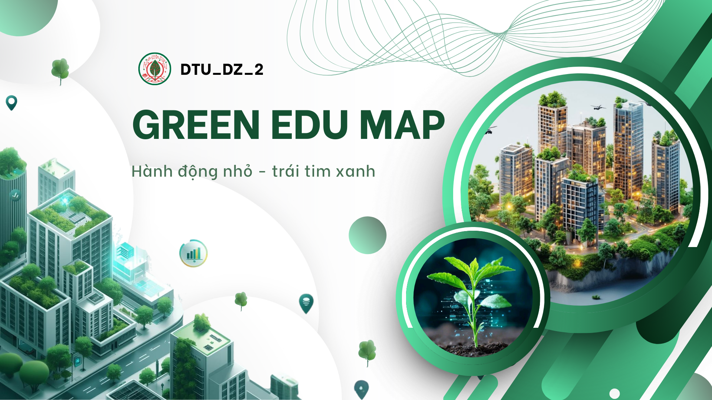
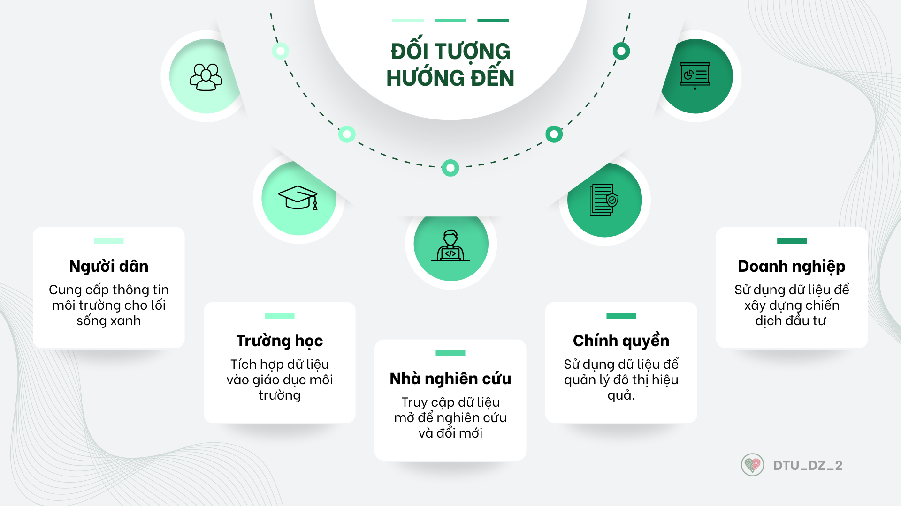
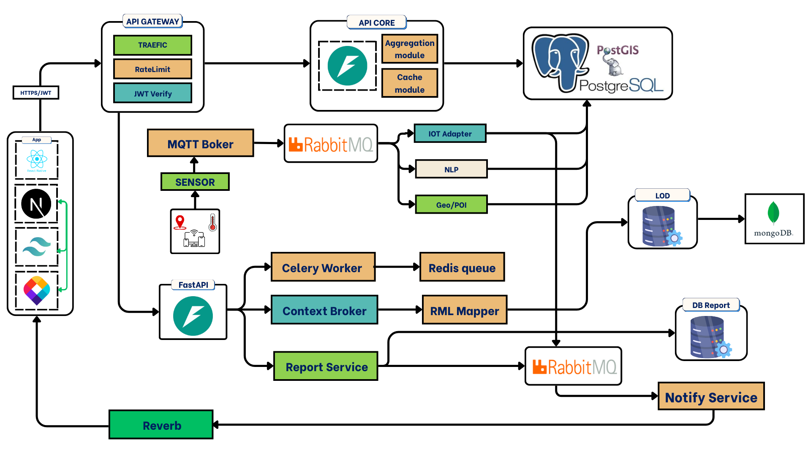

# 🌿 GreenEduMap - Dữ liệu mở dẫn lối đô thị xanh

<div align="center">

[](LICENSE)

**🤝 [Đóng Góp](CONTRIBUTING.md)** • **📜 [Changelog](CHANGELOG.md)**

</div>

<div align="center">

[](https://greenedumap.io.vn) [](https://hoduongquochuy278.github.io/GreenEduMap-DTUDZ-documents/intro/)

</div>



> _"Xanh hơn mỗi ngày – Dữ liệu vì cộng đồng xanh 🌍"_

## 📖 Tổng Quan

**GreenEduMap** là nền tảng mã nguồn mở (**Bản đồ dữ liệu mở và AI cảnh báo môi trường theo vị trí cho Smart Campus và đô thị thích ứng**) do đội **DTU-DZ_2** đến từ **Đại học Duy Tân** phát triển để tham gia cuộc thi **Smart City 2026 • ISSCEI 2026** (nhóm lĩnh vực *Giám sát thông minh – Smart monitoring*), với mục tiêu:

🤝 **Kết nối người dân – trường học – chính quyền** bằng bản đồ tri thức.
🔍 **Minh bạch hóa dữ liệu đô thị** theo từng khu vực (kèm nguồn, thời điểm và mức tin cậy) để cộng đồng dễ tiếp cận.
🤖 **Tối ưu hóa quy trình ra quyết định bằng AI** giúp cảnh báo rủi ro và gợi ý hành động xanh phù hợp từng vị trí.
🎓 **Thúc đẩy giáo dục bền vững** và khuyến khích cộng đồng cùng đóng góp, theo dõi xử lý sự cố.

Dự án tập trung hình thành một nền tảng toàn diện kết hợp AI, GIS (PostGIS), OpenData (NGSI-LD) và dashboard thời gian thực theo liên kết **WEFE (Nước – Năng lượng – Thực phẩm – Hệ sinh thái)** để tạo nên hệ sinh thái đô thị thích ứng, minh bạch, xanh và có khả năng mở rộng cho nhiều địa phương.

> 🎬 **Video demo:** [YouTube](https://youtu.be/CzMfeL2TTvE)

---

## 👥 Dự án này dành cho ai?



1. **Người dân & Sinh viên** → xem chất lượng sống, nhận cảnh báo ô nhiễm, nắng nóng, mưa ngập theo khu vực/tuyến đi và nhận gợi ý hành động xanh, gửi phản ánh hiện trường kèm ảnh GPS.
2. **Chính quyền** → ra quyết định dựa trên dữ liệu, theo dõi hàng đợi xác minh phản ánh và rủi ro theo địa bàn để quản lý đô thị hiệu quả.
3. **Trường học** → triển khai giáo dục xanh (Green Skills), điều chỉnh lịch hoạt động ngoài trời và tích hợp dữ liệu vào giáo dục môi trường.
4. **Tổ chức môi trường & Doanh nghiệp** → sử dụng dữ liệu để giám sát, xây dựng chiến dịch truyền thông và đầu tư xanh dựa trên dữ liệu thật.
5. **Nhà nghiên cứu** → truy cập dữ liệu mở chuẩn hóa (NGSI-LD, CSV/GeoJSON) để nghiên cứu và đổi mới, xây dựng mô hình AI/ML.
---

## ✨ Modules chính của GreenEduMap

### 1. 📱 Module tương tác người dân & sinh viên

🌍 Xem dữ liệu môi trường realtime (chất lượng không khí PM2.5/AQI, nhiệt độ, mưa – ngập, giao thông)

🏫 Tìm kiếm trường học xanh, điểm tài nguyên xanh và khóa học bền vững (Green Skills)

📍 Gửi phản ánh cộng đồng 4 trạng thái (`đã gửi – tiếp nhận – đang xác minh – đã xử lý`) kèm ảnh GPS, chống trùng, tự động xóa EXIF và che thông tin cá nhân

💡 Nhận cảnh báo theo vị trí (kèm nguồn, thời điểm, mức tin cậy) và gợi ý hành động xanh từ AI GreenBot

### 2. 🤖 Module phân tích AI & Dữ liệu

🧠 **AI GreenBot**: Diễn giải chỉ số môi trường bằng ngôn ngữ phổ thông, phân tích tương quan đa lớp

📈 Phân cụm K-Means khu vực (Xanh – Vàng – Đỏ) dựa trên chỉ số môi trường

🔮 Dự báo xu hướng ô nhiễm, điểm nóng nhiệt và biến động mảng xanh

⭐ Minh bạch độ tin cậy: tách bạch dữ liệu đo thực tế, dữ liệu dự báo và phản ánh chưa xác minh

### 3. 🗺️ Module quản lý dữ liệu môi trường, giáo dục & WEFE

🌡️ Thu thập và quản lý 6 lớp dữ liệu không gian: không khí (OpenAQ/IoT), thời tiết – mưa (OpenWeather), điểm ngập, giao thông (OSM), cây xanh – tái chế – rác hữu cơ, trường học & cộng đồng

🏫 Quản lý trường học, khóa học xanh, điểm thu gom rác hữu cơ/vườn trường và tính toán Green Score

🗺️ Bản đồ 2D/3D realtime hiển thị dữ liệu môi trường – giáo dục – chuỗi liên kết **WEFE** (Nước – Năng lượng – Thực phẩm – Hệ sinh thái)

📊 Dashboard trực quan cho chính quyền và trường học

### 4. 📊 Module quản trị hệ thống & OpenData

📉 Dashboard tổng quan và báo cáo KPI cho cơ quan quản lý

🔗 API mở theo chuẩn NGSI-LD và Linked Open Data

📥 Export dữ liệu đa định dạng (JSON, CSV, GeoJSON, RDF)

⚙️ Phân quyền, quản lý người dùng và giám sát hệ thống

---

## 🧱 Kiến trúc hệ thống



### Thành phần và công nghệ sử dụng

| Thành phần         | Công nghệ sử dụng                                       |
| ------------------ | ------------------------------------------------------- |
| **Web App**        | Next.js 14 |
| **Mobile App**     | React Native (iOS & Android)                            |
| **Backend Core**   | FastAPI (Python), Redis (cache), JWT |
| **AI/ML Service**  | Python 3.11, scikit-learn, pandas, aio-pika             |
| **Message Broker** | RabbitMQ, MQTT (EMQX)                                   |
| **Database**       | PostgreSQL + PostGIS, MongoDB                           |
| **Semantic Layer** | FiWARE Orion-LD (NGSI-LD)                               |
| **Real-time**      | WebSocket                                               |

---

## 🔗 Linked Open Data - NGSI-LD

GreenEduMap tuân thủ chuẩn **NGSI-LD** (ETSI GS CIM 009) nhằm chia sẻ dữ liệu đô thị xanh theo hướng Linked Open Data và tương thích với hệ sinh thái **FiWARE Orion-LD** đang được nhiều thành phố thông minh sử dụng.

### Vì sao NGSI-LD cho GreenEduMap?
- **Chuẩn quốc tế**: NGSI-LD bảo đảm dữ liệu môi trường – giáo dục tuân thủ đặc tả ETSI, dễ dàng kết nối với nền tảng Smart City khác.
- **Interoperability**: Entity có URI chuẩn (`urn:ngsi-ld:AirQuality:...`, `urn:ngsi-ld:School:...`) nên tích hợp song song với GIS, dashboard của địa phương.
- **Linked Data**: JSON-LD cho phép gắn ngữ nghĩa (SOSA/SSN, Smart Data Models) giúp AI phân tích quan hệ môi trường ↔ giáo dục.
- **Open Data**: API công khai phục vụ nhà nghiên cứu, startup xây ứng dụng xanh mà không cần phụ thuộc vào nền tảng độc quyền.

### API endpoints chính

```text
# Liệt kê entity Linked Data
GET    /api/ngsi-ld/v1/entities
GET    /api/ngsi-ld/v1/entities?type=AirQuality
GET    /api/ngsi-ld/v1/entities?type=School

# Chi tiết & truy vấn thời gian
GET    /api/ngsi-ld/v1/entities/{id}
GET    /api/ngsi-ld/v1/temporal/entities/{id}

# Ghi/đăng ký
POST   /api/ngsi-ld/v1/entities              (Content-Type: application/ld+json)
PATCH  /api/ngsi-ld/v1/entities/{id}/attrs
POST   /api/ngsi-ld/v1/subscriptions         (webhook khi AQI hoặc điểm xanh thay đổi)
```

### Smart Data Models tiêu biểu

- `AirQualityObservation` (FiWARE Smart Data Models): thuộc tính `aqi`, `pm25`, `observedAt`, `location` (GeoProperty - GeoJSON Point), `source`.
- `School`/`GreenSchool`: thuộc tính `greenScore`, `facilities`, `courseCatalog`, `address`, `status`.


> 📚 Chi tiết cấu trúc NGSI-LD và context JSON-LD được mô tả trong `PROJECT_WORK.md` và các tài liệu trong thư mục `docs/`.

---

## 🧩 Hướng Phát Triển

Dự án hướng tới xây dựng hệ sinh thái đô thị xanh thông minh, không chỉ dừng lại ở hiển thị dữ liệu mà còn mở rộng khả năng dự báo, tự động hóa và kết nối cộng đồng.

### 🌐 Mở rộng & Kết nối

- Triển khai đa đô thị: Mở rộng GreenEduMap cho nhiều thành phố, hỗ trợ đa ngôn ngữ
- Bản đồ 3D thời gian thực: Hiển thị lớp dữ liệu môi trường – giáo dục – năng lượng với vùng cảnh báo.
- Nền tảng cộng đồng xanh: Kết nối người dân – trường học – doanh nghiệp thông qua dữ liệu mở và hoạt động xanh.

### 🧠 Nâng cấp AI & Dữ liệu

- Dự báo xu hướng đô thị: Phân tích dữ liệu lịch sử để dự đoán ô nhiễm không khí, nhiệt độ và biến động mảng xanh.
- AI GreenBot nâng cao: Học từ dữ liệu người dùng đóng góp và cảm biến IoT môi trường.
- Phân tích hình ảnh vệ tinh: Tự động nhận diện thay đổi cây xanh, bê tông hóa từ ảnh Sentinel.

### 🔗 Dữ liệu mở & Minh bạch

- Chuẩn hóa dữ liệu mở: Áp dụng NGSI-LD, RDF/JSON-LD để chia sẻ dữ liệu môi trường và giáo dục.
- API mở: Cho phép sinh viên, nhà nghiên cứu và startup phát triển các ứng dụng xanh trên nền tảng.
- Quản lý chất lượng dữ liệu: Theo dõi nguồn gốc dữ liệu (data lineage) và độ tin cậy.

### 🌍 Tầm nhìn dài hạn

- Xây dựng bản sao số đô thị xanh 3D, mô phỏng môi trường – giáo dục – năng lượng, dự báo xu hướng và gợi ý giải pháp tối ưu.
- Kết nối người dân, trường học, doanh nghiệp và chính quyền trong một hệ sinh thái dữ liệu mở.
- Ứng dụng AI dự báo ô nhiễm, thay đổi cây xanh và năng lượng, giúp ra quyết định nhanh và bền vững.
- Triển khai GreenEduMap tại nhiều thành phố Đông Nam Á, chuẩn hóa dữ liệu theo NGSI-LD và Linked Open Data, trở thành trung tâm dữ liệu đô thị xanh mã nguồn mở hàng đầu khu vực.

---

# 📘 Hướng dẫn cài đặt GreenEduMap

## 📋 Yêu cầu hệ thống

### Phần mềm cần thiết

| Công cụ | Phiên bản tối thiểu | Mục đích |
|---------|---------------------|----------|
| **Docker** | 20.10+ | Container runtime |
| **Docker Compose** | 2.0+ | Orchestration |
| **Git** | 2.30+ | Version control |

### Phần cứng khuyến nghị

- **CPU**: 4 cores trở lên
- **RAM**: 8GB tối thiểu, 16GB khuyến nghị
- **Disk**: 50GB trống
- **Network**: Kết nối internet ổn định

---

## 🚀 Cài đặt và Khởi chạy

### 1. Clone repository

```bash
# Clone dự án
git clone https://github.com/MNM-DTU-DZ2/GreenEduMap-DTUDZ.git
cd GreenEduMap-DTUDZ
```

### 2. Cấu hình môi trường

```bash
# Copy file môi trường mẫu
cp infrastructure/docker/.env.example infrastructure/docker/.env

# Chỉnh sửa file .env với thông tin của bạn
nano infrastructure/docker/.env
```

**Các biến môi trường quan trọng:**

```env
# Database
POSTGRES_DB=greenedumap
POSTGRES_USER=postgres
POSTGRES_PASSWORD=your_password

# Ports
API_GATEWAY_PORT=4500
WEB_APP_PORT=4501

# API Keys
OPENAQ_API_KEY=your_openaq_key
OPENWEATHER_API_KEY=your_openweather_key

# Authentication
JWT_SECRET_KEY=your_jwt_secret
```

### 3. Khởi động với Docker Compose

```bash
# Di chuyển vào thư mục docker và khởi động tất cả services
cd infrastructure/docker
docker compose up -d

# Kiểm tra trạng thái
docker compose ps

# Xem logs
docker compose logs -f
```

Hệ thống sẽ tự động khởi động các thành phần:
- **Frontend**: Next.js (Web) & React Native (Mobile support)
- **Backend**: FastAPI (API Gateway & microservices)
- **Database**: PostgreSQL + PostGIS, MongoDB, Redis
- **Message Broker**: RabbitMQ, EMQX (MQTT)
- **AI Services**: Python Services
- **Auth**: Auth Service (JWT)
- **Semantic / OpenData**: OpenData Service (NGSI-LD)

---

## ✅ Kiểm tra cài đặt

### Health Check Script

```bash
#!/bin/bash
# health-check.sh

echo "Checking services..."

# Frontend
curl -f http://localhost:3000 && echo "✅ Frontend OK" || echo "❌ Frontend Failed"

# Backend
curl -f http://localhost:8000/health && echo "✅ Backend OK" || echo "❌ Backend Failed"

# AI Services
curl -f http://localhost:8001/health && echo "✅ AI Services OK" || echo "❌ AI Services Failed"

# Database
pg_isready -h localhost -p 5432 && echo "✅ Database OK" || echo "❌ Database Failed"

# Redis
redis-cli ping && echo "✅ Redis OK" || echo "❌ Redis Failed"

# RabbitMQ
curl -f http://localhost:15672 && echo "✅ RabbitMQ OK" || echo "❌ RabbitMQ Failed"
```

---

## 🐛 Xử lý sự cố

### Lỗi thường gặp

**1. Port đã được sử dụng**
```bash
# Kiểm tra port đang sử dụng
netstat -ano | findstr :3000

# Dừng process
taskkill /PID <process_id> /F
```

**2. Docker container không khởi động**
```bash
# Xem logs chi tiết
docker logs <container_name>

# Restart container
docker restart <container_name>

# Xóa và tạo lại
docker-compose down
docker-compose up -d --force-recreate
```

**3. Database connection failed**
```bash
# Kiểm tra PostgreSQL đang chạy
docker ps | grep postgres

# Test connection
psql -h localhost -U postgres -d greenedumap
```

---

## 🔐 Cấu hình bảo mật

### SSL/TLS Certificate

```bash
# Tạo self-signed certificate cho development
openssl req -x509 -nodes -days 365 -newkey rsa:2048 \
  -keyout ./certs/key.pem \
  -out ./certs/cert.pem
```

### Firewall Rules

```bash
# Mở ports cần thiết
sudo ufw allow 3000/tcp  # Frontend
sudo ufw allow 8000/tcp  # Backend
sudo ufw allow 5432/tcp  # PostgreSQL
sudo ufw allow 6379/tcp  # Redis
```

---

## 📊 Monitoring & Logging

### Prometheus + Grafana

```bash
# Khởi động monitoring stack
docker-compose -f docker-compose.monitoring.yml up -d
```

**Grafana Dashboard:** http://localhost:3001

### Log Aggregation

```bash
# Xem logs tất cả services
docker-compose logs -f

# Xem logs một service cụ thể
docker-compose logs -f backend
```

---

## 📚 Tài liệu tham khảo

- [Architecture](./docs/ARCHITECTURE.md) - Kiến trúc hệ thống
- [API Documentation](./docs/API_DOCUMENTATION.md) - Tài liệu API
- [Setup Guide](./Setup.md) - Hướng dẫn cài đặt chi tiết
- [Contributing](./CONTRIBUTING.md) - Hướng dẫn đóng góp

---

## 📁 Cấu trúc thư mục

```
GreenEduMap-DTUDZ/
│
├── modules/                     # All Application Modules
│   ├── appmobile/              # React Native Mobile App (iOS & Android)
│   ├── web-app/                # Next.js 14 Web Application - Port 3000
│   ├── api-gateway/            # API Gateway (FastAPI) - Port 8000
│   ├── auth-service/           # Authentication Service - Port 8001
│   ├── resource-service/       # Green Zones, Recycling Centers - Port 8002
│   ├── education-service/      # Schools, Green Courses - Port 8003
│   ├── environment-service/    # Air Quality, Weather
│   ├── data-ingestion-service/ # Data Collectors & Ingestion
│   ├── ai-service/             # ML Models (RabbitMQ Workers)
│   ├── opendata-service/       # NGSI-LD, Linked Open Data
│   └── shared/                 # Shared utilities, models, configs
│
├── infrastructure/              # Docker & Deployment
│   ├── docker/                 # Docker Compose, Dockerfiles
│   │   ├── init-scripts/       # Database init scripts (SQL)
│   │   └── configs/            # Service configurations
│   └── nginx/                  # Nginx reverse proxy configs
│
├── docs/                        # Documentation
│   ├── ARCHITECTURE.md         # System architecture details
│   ├── API_DOCUMENTATION.md    # API endpoints documentation
│   ├── API_ENDPOINTS.md        # API endpoints summary
│   ├── PROJECT.md              # Project overview
│   ├── PROJECT_CONTEXT.md      # Project context & background
│   ├── DEPLOYMENT.md           # Deployment guide
│   ├── VPS_DEPLOYMENT_GUIDE.md # VPS deployment instructions
│   ├── BUILD_WITHOUT_DOCKER.md # Build without Docker guide
│   ├── SSL_SETUP_GUIDE.md      # SSL setup guide
│   └── DOCKER.md               # Docker usage guide
│
├── scripts/                     # Utility Scripts
│   ├── deploy/                 # Deployment scripts
│   ├── test/                   # Testing scripts
│   └── git/                    # Git helper scripts
│
├── collections/                 # API Collections
│   └── postman/                # Postman collections for testing
│
├── assets/                      # Static Assets
│   └── images/                 # Project images, banners, diagrams
│
├── .github/                     # GitHub Configuration
│   └── workflows/              # CI/CD pipelines
│
├── README.md                    # Main documentation
├── CONTRIBUTING.md              # Contribution guidelines
├── CODE_OF_CONDUCT.md           # Code of conduct
├── CHANGELOG.md                 # Version history
├── LICENSE                      # GPL-3.0 License
└── cliff.toml                   # Git cliff configuration
```

---

## 🧪 Kiểm thử

```bash
# Backend service (ví dụ api-gateway)
cd modules/api-gateway
pytest -v

# Web Frontend
cd modules/web-app
npm run test
```

---

## 📄 Tài liệu liên quan

| File | Mô tả |
| ----------------------------- | ---------------------- |
| `docs/ARCHITECTURE.md` | Kiến trúc chi tiết |
| `docs/API_DOCUMENTATION.md` | API đầy đủ |
| `docs/PROJECT.md` | Tổng quan dự án |
| `CONTRIBUTING.md` | Quy tắc đóng góp |

---

## 🤝 Đóng Góp Cho Dự Án

Dự án này là mã nguồn mở, được phát triển bởi đội **DTU-DZ_2** đến từ **Đại học Duy Tân** để tham gia cuộc thi **Smart City 2026 • ISSCEI 2026** nên rất hoan nghênh cộng đồng tham gia đóng góp!

### 🌱 Quy Trình Đóng Góp

#### 1. Fork Repository

```bash
# Fork repository trên GitHub
# Clone về máy local
git clone https://github.com/MNM-DTU-DZ2/GreenEduMap-DTUDZ.git
cd GreenEduMap-DTUDZ
```

#### 2. Tạo Branch Mới

```bash
# Tạo và chuyển sang branch mới
git checkout -b feat/<new-feature>

# Ví dụ
git checkout -b feat/air-quality-api
```

#### 3. Commit Thay Đổi

```bash
# Thêm file đã thay đổi
git add .

# Commit với message rõ ràng
git commit -m "feat: add air quality API module"
```

#### 4. Push Branch

```bash
# Push lên repository của bạn
git push -u origin feat/<new-feature>
```

#### 5. Tạo Pull Request

- Truy cập repository gốc tại GitHub
- Chọn "New Pull Request"
- Chọn branch của bạn để merge
- Điền thông tin mô tả chi tiết

### 📝 Issues

Báo cáo lỗi và đề xuất tính năng mới tại [GitHub Issues](https://github.com/MNM-DTU-DZ2/GreenEduMap-DTUDZ/issues)

Xem thêm hướng dẫn đóng góp tại [CONTRIBUTING.md](CONTRIBUTING.md)

---

## ⚖️ Quy Tắc Ứng Xử

Dự án này tuân theo bộ quy tắc ứng xử cho cộng đồng. Xem file [CODE_OF_CONDUCT.md](CODE_OF_CONDUCT.md) để biết thêm chi tiết về các quy tắc và hành vi được chấp nhận.

## 👥 Người Hướng Dẫn

| 👨‍🏫 Vai Trò | 📧 Thông Tin | 📧 Email|
| ----------- | ------------ | ------------ |
| **Giảng Viên Hướng Dẫn** | **Th.S Trần Kim Sanh** | **trankimsanh@dtu.edu.vn** |

### 📞 Liên hệ Team DTU-DZ2

Nếu cần trao đổi gì thêm, vui lòng liên hệ:

- **Trần Xuân Trường** *(Trưởng nhóm)*: xuantruong081205@gmail.com
- **Hồ Dương Quốc Huy**: huyho2782005@gmail.com
- **Võ Thị Thái Ngọc**: vothithaingoc207@gmail.com

---

## 📜 License

Dự án này được phân phối dưới [GNU General Public License v3.0](LICENSE). Xem file `LICENSE` để biết thêm chi tiết.

## 📱 GreenEduMap Application

<div align="center">
  <table>
    <tr>
      <td align="center" width="200">
        
        <br/><br/>
        
      </td>
      <td width="80"></td>
      <td align="center" width="200">
        
        <br/><br/>
        
      </td>
    </tr>
  </table>
</div>

---

© 2026 **GreenEduMap** - Dữ liệu mở dẫn lối đô thị xanh 🌱

